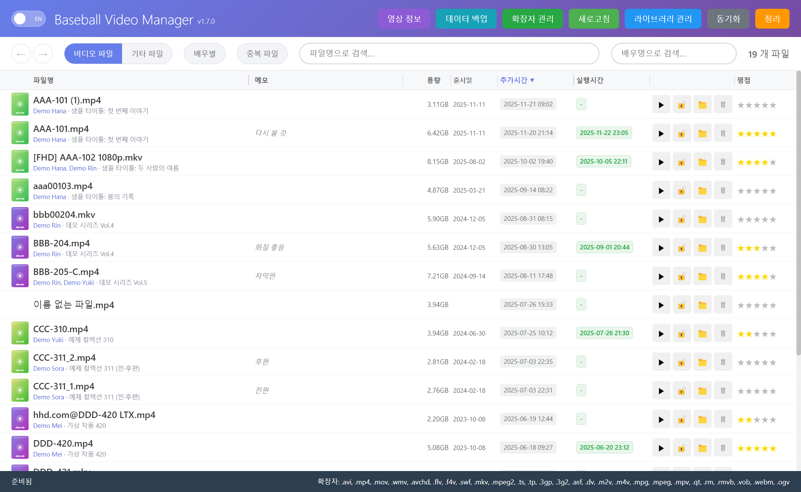
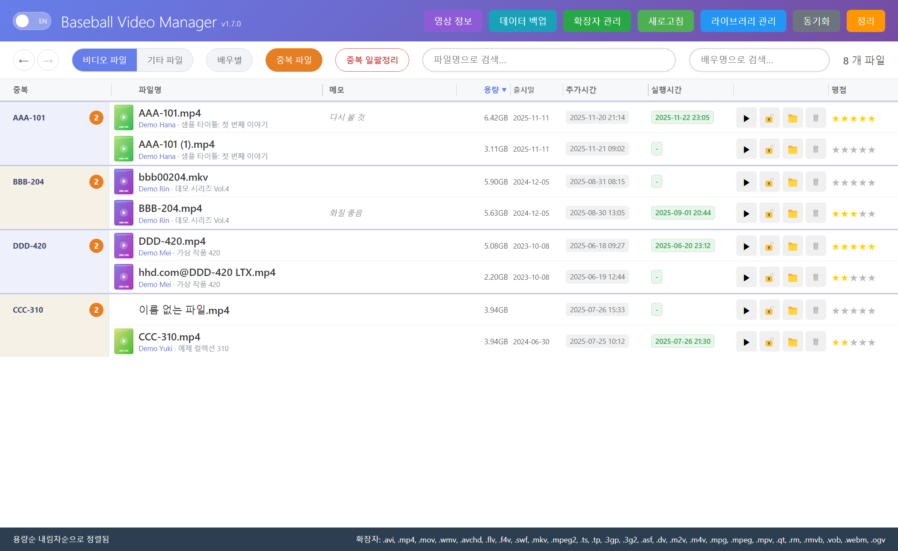
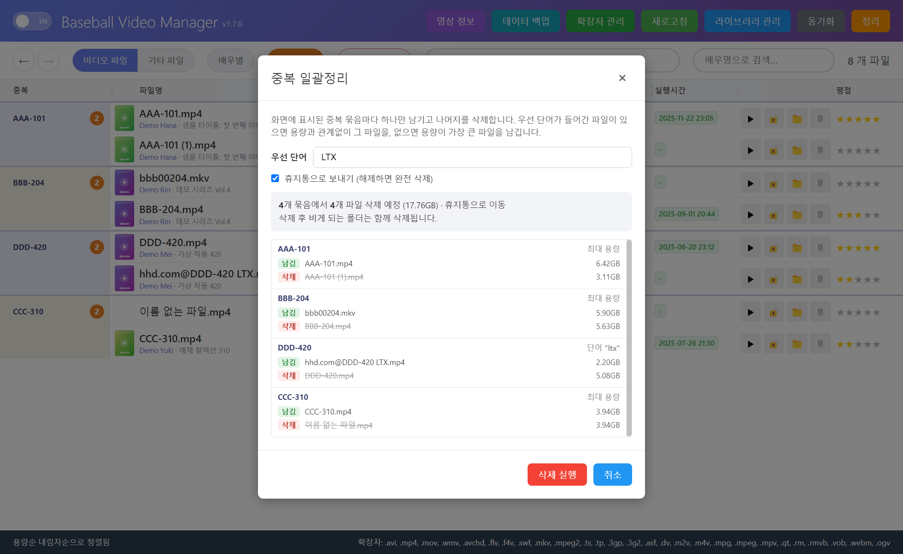
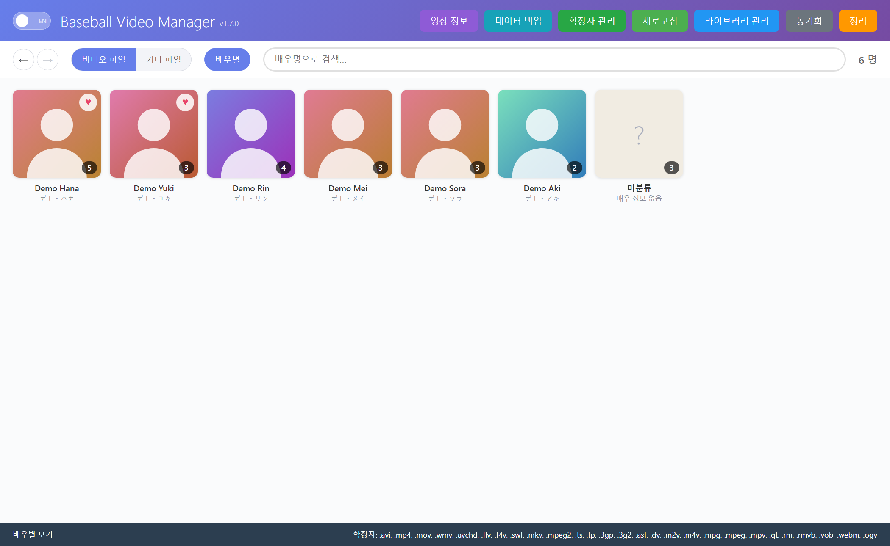
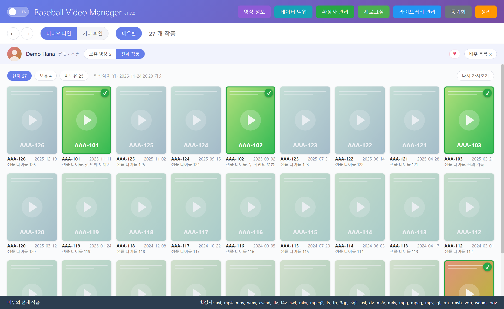
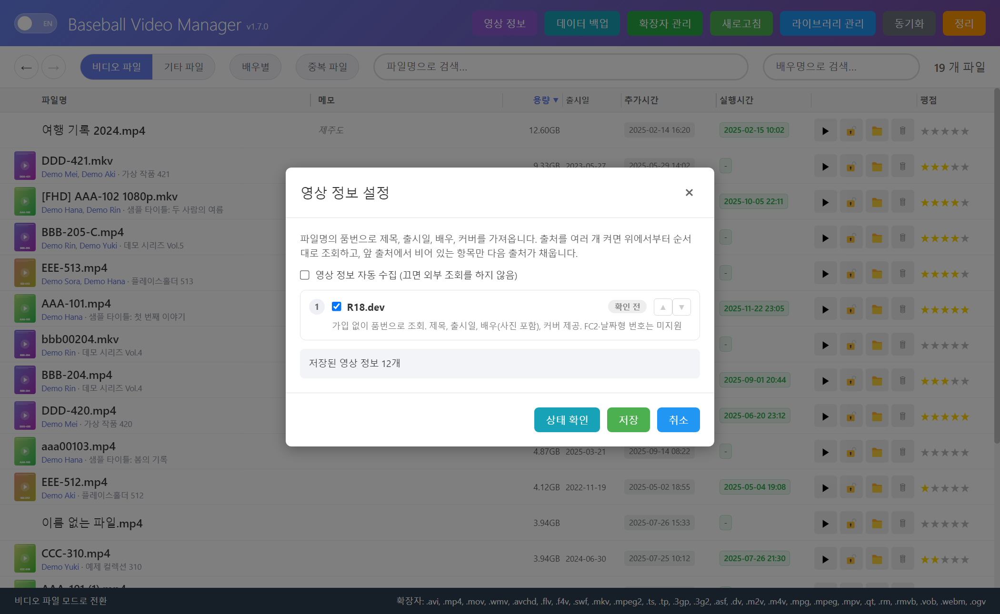

# Baseball Video Manager

여러 드라이브에 흩어진 동영상 파일을 한 화면에서 검색·정렬·평가하고, 중복을 정리하고, 품번으로 영상 정보를 붙여 주는 Windows용 데스크톱 앱입니다.



> 스크린샷은 모두 가상의 데모 데이터와 플레이스홀더 이미지로 찍은 것입니다.


---

## 설치

[Releases](../../releases/latest)에서 내려받습니다.

| 파일 | 설명 |
|---|---|
| `Baseball-Video-Manager-Setup-x.y.z.exe` | 설치판 (권장). 자동 업데이트를 지원합니다 |
| `Baseball-Video-Manager-Portable-x.y.z.exe` | 설치 없이 실행하는 단일 파일. 자동 업데이트는 지원하지 않습니다 |

- 코드 서명이 없어 처음 실행할 때 Windows SmartScreen 경고가 나올 수 있습니다. "추가 정보 → 실행"으로 진행합니다.
- 데이터는 `%APPDATA%\Baseball Video Manager\data`에 저장되며, 업데이트하거나 다시 설치해도 유지됩니다.
- Git 동기화 기능을 쓰려면 PC에 [Git](https://git-scm.com/)이 설치되어 있어야 합니다.

## 시작하기

1. **라이브러리 관리**에서 동영상이 들어 있는 폴더를 추가합니다. 여러 드라이브의 폴더를 함께 등록할 수 있습니다.
2. 앱이 폴더를 스캔해 목록을 만듭니다. 이후에는 시작할 때와 **새로고침**(F5)을 누를 때 추가·삭제된 파일을 반영합니다.
3. 별을 눌러 평점을 주고, 메모 칸을 눌러 메모를 적습니다. 더블클릭하거나 ▶ 버튼으로 기본 플레이어에서 재생합니다.

---

## 기능

### 목록

- **컬럼 정렬** — 파일명 / 메모 / 용량 / 출시일 / 추가시간 / 실행시간 / 평점 헤더를 누르면 정렬하고, 다시 누르면 방향이 바뀝니다. 정렬 상태는 다음 실행에도 유지됩니다.
- **검색** — 파일명 검색과 배우명 검색을 함께 쓸 수 있습니다.
- **평점과 메모** — 5단계 별점, 인라인 메모(Enter 저장, Esc 취소).
- **재생 기록** — 마지막으로 실행한 시각을 기록합니다.
- **비디오 / 기타 탭** — 동영상과 압축 파일 등을 나눠 관리합니다. 각 탭의 확장자는 **확장자 관리**에서 바꿉니다.
- **폭 조절** — 파일명과 메모 사이의 경계를 끌어 두 칸의 폭을 조절합니다.
- **뒤로 / 앞으로** — 탭, 중복 보기, 배우 보기 사이의 이동을 기억합니다.
- **대용량 목록** — 화면에 보이는 행만 그리므로 수천 개 파일도 부드럽게 스크롤됩니다.

### 중복 파일 정리



**중복 파일** 버튼을 누르면 중복으로 보이는 파일만 묶어서 보여 줍니다. 아래 중 하나라도 같으면 같은 묶음입니다.

| 기준 | 예 |
|---|---|
| 품번 | `AAA-101.mp4`, `aaa00101.mkv`, `site.com@AAA-101-C.mp4` |
| 같은 이름 (품번이 없는 파일) | `여행.mp4`, `여행 (1).mp4`, `여행 - 복사본.mkv` |
| 같은 용량 (바이트 단위) | 이름이 전혀 달라도 용량이 완전히 같은 파일 |

다음은 중복으로 보지 않습니다.

- 품번 뒤의 분할 번호가 다른 파일 (`AAA-101_1`과 `AAA-101_2`, `cd1`과 `cd2`)
- 전부 같은 폴더 안에 있는 파일
- `1.mp4`, `video.mp4`처럼 대충 지은 이름 (용량이 같으면 묶습니다)
- `1080p`, `x264` 같은 화질·코덱 표기



**중복 일괄정리**는 묶음마다 하나만 남기고 나머지를 지웁니다.

- 우선 단어가 파일명에 들어간 파일이 있으면 용량과 관계없이 그 파일을 남깁니다.
- 없으면 용량이 가장 큰 파일을 남깁니다.
- 실행 전에 무엇을 남기고 지울지 미리보기로 확인합니다.
- 기본값은 휴지통으로 보내기입니다.
- 지워지는 파일의 평점이 더 높으면 남는 파일에 옮겨 줍니다.
- 분할 파일로 보이거나 용량을 모르는 묶음은 건너뜁니다.

### 영상 정보와 배우 보기



파일명에 품번이 있으면 제목, 출시일, 배우, 커버를 백그라운드에서 가져와 목록에 표시합니다.

- **배우별** — 배우 썸네일을 격자로 보여 줍니다. 카드를 누르면 그 배우의 보유 영상만 목록으로 봅니다.
- **좋아요** — 좋아요한 배우가 맨 앞에 옵니다.
- **전체 작품** — 배우의 모든 작품을 최신작부터 보여 주고, 보유한 작품에는 체크 표시가 붙습니다.



정보는 품번당 한 번만 조회해 저장하므로 다음부터는 바로 표시됩니다. 새로 추가된 영상은 자동으로 조회합니다.



**영상 정보** 설정에서 자동 수집을 끄거나 출처의 사용 여부와 우선순위를 정하고, 출처가 응답하는지 확인할 수 있습니다.

- 현재 제공하는 출처는 [R18.dev](https://r18.dev)입니다. 자동 수집이 켜져 있으면 영상의 품번이 이 사이트로 전송됩니다.
- 출처의 요청 제한 때문에 조회는 천천히 진행됩니다. 영상이 많으면 첫 수집에 몇 시간이 걸릴 수 있고, 앱을 다시 켜면 이어서 진행합니다.
- FC2, 날짜형 번호, 품번이 없는 파일은 조회되지 않고 "미분류"로 모입니다.

### 삭제

- 삭제 후 폴더가 비면 그 폴더도 함께 지웁니다. 라이브러리 폴더 자체는 지우지 않습니다.
- 다른 프로그램이 파일을 잡고 있어 삭제가 막히면, 그 프로그램에 창 닫기를 요청한 뒤 다시 시도합니다.
- 행의 삭제 버튼은 파일을 완전히 삭제합니다. 휴지통 이동은 중복 일괄정리에서만 지원합니다.

### 데이터 보호

- **안전한 저장** — 임시 파일에 쓴 뒤 교체하므로, 저장 도중 꺼져도 기존 파일이 깨지지 않습니다.
- **자동 복구** — 데이터 파일이 손상되면 직전 버전(`.bak`)에서 복구합니다.
- **덮어쓰기 차단** — 복구도 안 되면 저장과 새로고침을 멈춰 평점·메모가 지워지지 않게 합니다.
- **끊긴 드라이브 보존** — 외장·네트워크 드라이브가 연결되어 있지 않으면 그 안의 항목을 지우지 않습니다.

### 백업과 동기화

- **데이터 백업** — `data` 폴더를 ZIP 파일로 저장합니다.
- **동기화** — 평점·메모·영상 정보를 Git 저장소(GitHub 등)에 올리고, 다른 PC에서 내려받습니다. 자동 동기화를 켜면 변경 후 30초 뒤에 올립니다.
- 배우 좋아요와 출처 설정(`data/local`)은 이 PC에만 저장하고 올리지 않습니다.

### 자동 업데이트

설치판은 시작할 때 새 버전을 확인해 백그라운드로 내려받습니다. 다 받으면 지금 다시 시작할지 묻고, 나중에를 고르면 앱을 종료할 때 설치합니다. 프로그램 이름 옆의 버전을 누르면 바로 확인합니다.

---

## 단축키

| 키 | 동작 |
|---|---|
| `Ctrl+F` | 검색창으로 이동 |
| `F5` / `Ctrl+R` | 새로고침 |
| `Ctrl+1` / `Ctrl+2` | 비디오 탭 / 기타 탭 |
| `Ctrl+L` | 라이브러리 관리 |
| `Alt+←` / `Alt+→` | 뒤로 / 앞으로 (마우스의 뒤로·앞으로 버튼도 동작) |

## 데이터 위치

`%APPDATA%\Baseball Video Manager\data`

| 경로 | 내용 | Git 동기화 |
|---|---|---|
| `lib.json` | 라이브러리 폴더 목록 | 포함 |
| `media/files.json`, `file/files.json` | 파일 목록, 평점, 메모, 시각, 용량 | 포함 |
| `extensions.json` | 탭별 확장자 | 포함 |
| `meta/videos.json`, `meta/actresses/` | 수집한 영상 정보, 배우 작품 목록 | 포함 |
| `local/` | 배우 좋아요, 출처 설정 | 제외 |
| `sync-settings.json` | 동기화 저장소 주소와 토큰 | 제외 |

커버와 배우 이미지는 `%APPDATA%\Baseball Video Manager\meta-cache`에 저장됩니다. 지워도 필요할 때 다시 받습니다.

---

## 개발

```bash
npm install
npm start          # 실행 (데이터는 %APPDATA% 사용)
npm run dev        # 개발자 도구와 함께 실행 (데이터는 프로젝트 상위 폴더의 data 사용)
```

### 빌드

```bash
npm run build:win        # Windows에서: Setup + Portable (dist/)
npm run build:win-test   # WSL에서: 테스트용 빌드를 만들어 Windows의 Downloads 폴더로 복사
```

WSL에서 `npm run build`를 실행하면 Linux용이 만들어집니다. 또한 Electron은 `\\wsl.localhost\...` 경로에서 실행되지 않으므로, WSL에서 만든 빌드는 로컬 드라이브로 복사해서 실행해야 합니다. `build:win-test`가 이 과정을 대신합니다.

### 릴리스

1. `package.json`의 `version`을 올립니다.
2. Windows에서 `npx electron-builder --win --publish never`로 빌드합니다.
3. `dist`의 Setup exe, `.blockmap`, `latest.yml`, Portable exe를 `vX.Y.Z` 태그의 GitHub 릴리스에 올립니다. `latest.yml`이 있어야 자동 업데이트가 새 버전을 찾습니다.

### 구조

```
src/
├── main/                          # Electron 메인 프로세스
│   ├── electron.js                # 창, IPC 핸들러, 스캔, 삭제
│   ├── json-store.js              # JSON 원자적 저장, .bak 복구
│   ├── data-sync.js               # Git 동기화
│   ├── auto-update.js             # 자동 업데이트
│   ├── file-unlocker.js           # 파일을 잡고 있는 프로그램 닫기
│   ├── local-time.js              # 시스템 시간 기준 타임스탬프
│   └── metadata/
│       ├── metadata-service.js    # 수집 대기열, 출처 병합, 이미지 캐시
│       └── sources/               # 출처 어댑터 (index.js에 등록)
└── renderer/                      # 화면 (프레임워크 없는 JavaScript)
    ├── index.html
    ├── styles/main.css
    └── js/
        ├── main.js                # 앱 초기화, 화면 이동, 정렬
        ├── file-manager.js        # 파일 목록 로드·스캔·저장·필터
        ├── virtual-scroll.js      # 행 목록 렌더링
        ├── duplicate-finder.js    # 품번 추출, 중복 묶음, 정리 계획
        ├── duplicate-cleaner.js   # 중복 일괄정리 창
        ├── metadata-manager.js    # 영상 정보, 이미지, 배우 좋아요
        ├── actress-view.js        # 배우 격자
        ├── works-view.js          # 배우의 전체 작품
        ├── meta-settings.js       # 영상 정보 설정 창
        ├── library-manager.js     # 라이브러리 관리 창
        ├── extension-manager.js   # 확장자 관리 창
        ├── search-engine.js       # 파일명 검색
        ├── i18n.js                # 한국어 / 영어
        └── utils.js
```

### 출처 추가하기

`src/main/metadata/sources/`에 어댑터 파일을 만들고 `index.js`에 등록합니다. 어댑터는 아래 항목을 내보냅니다. 자세한 규약은 `r18dev.js` 상단의 주석에 있습니다.

| 항목 | 설명 |
|---|---|
| `id`, `name`, `description` | 식별자와 설정 창에 표시할 문구 |
| `minInterval` | 요청 사이의 최소 간격(ms) |
| `imageHosts` | 이미지 내려받기를 허용할 호스트 |
| `configFields` | 설정 창에서 입력받을 값 (API 키 등) |
| `lookup(code, ctx)` | 품번으로 조회. 없으면 `null`, 일시적 오류는 예외 |
| `check(ctx)` | 서비스가 살아 있는지 확인 |
| `listWorks(actress, ctx)` | (선택) 배우의 전체 작품 목록 |

---

## 라이선스

MIT
